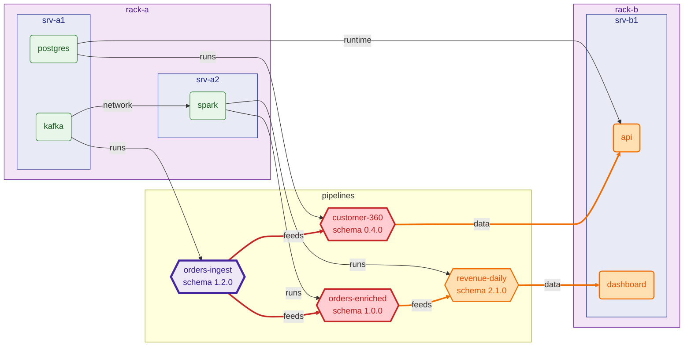

# RippleRack

**See the ripple before you make the splash.**

RippleRack is a local-first simulator for datacenters and data pipelines. You
describe your racks, servers, services and pipelines in a single YAML file and
RippleRack tells you what happens when something changes:

- 🧬 **Semantic versioning for data**: diff two versions of a schema and get
  `patch` / `minor` / `major`, the full list of changes and the version you
  should have declared.
- 🌊 **Cascading impact analysis**: walk the dependency graph to find every
  downstream pipeline, service and dashboard, which consumers actually break
  and how severe the whole change is.
- 🏗️ **Infrastructure simulation**: push the load up, take a server down and
  see what overloads and what goes offline with it.

Everything runs locally from a text file. There are no agents, no cloud
accounts and no databases.

> Status: **MVP 0.1**. The CLI and core engines work and are tested. The file
> format may still change.

## Why?

Infrastructure tools model machines. Data catalogs model tables. Schema
registries model compatibility. In real life a renamed column on a Kafka topic
breaks a Spark job, which empties a dashboard, which pages someone at 3 AM.
RippleRack puts all of that in **one graph**, so the question *"what breaks if I
ship this?"* has a concrete answer. You can run it before merging, inside CI,
or just to learn how these systems fit together.

## Installation

RippleRack requires Python 3.11+ and uses [uv](https://docs.astral.sh/uv/).

```bash
git clone https://github.com/IzanVil/RippleRack.git
cd RippleRack
uv sync
uv run ripplerack --help
```

To install the CLI globally from a checkout:

```bash
uv tool install .
ripplerack --help
```

## Quick tour

The repository ships with [`examples/mini_datacenter.yaml`](examples/mini_datacenter.yaml):
2 racks, 3 servers, 5 services and 4 pipelines forming an order analytics
stack.

### `validate`: check the file

```bash
uv run ripplerack validate examples/mini_datacenter.yaml
```

This checks types, unique ids, references between components, the fields that
consumers read and dependency cycles. Typos in keys are reported instead of
being silently ignored.

### `graph`: look at the dependency graph

```bash
uv run ripplerack graph examples/mini_datacenter.yaml            # tree in the terminal
uv run ripplerack graph examples/mini_datacenter.yaml -F dot -o dc.dot   # Graphviz
uv run ripplerack graph examples/mini_datacenter.yaml -F json    # machine readable
uv run ripplerack graph examples/mini_datacenter.yaml -F mermaid # Mermaid flowchart
```

`-F mermaid` prints a [Mermaid](https://mermaid.js.org) flowchart: racks and servers are
nested boxes, services and pipelines have their own shapes, and arrows are labelled with
the relation. Paste it between `mermaid` code fences in any Markdown file (GitHub renders
it) or save it with `-o graph.mmd` and render it with `mmdc`.

### `impact`: what breaks if this schema changes?

```bash
uv run ripplerack impact examples/mini_datacenter.yaml \
  --pipeline orders-ingest \
  --schema examples/changes/orders_v2.yaml
```

```text
─────────────────────── Impact of changing orders-ingest ───────────────────────
Schema orders 1.2.0 → 2.0.0   change: major   suggested version: 2.0.0
Schema changes
┏━━━━━━━┳━━━━━━━━━━━━━━━┳━━━━━━━━━━━━━━━━━━━━━━━━━━━━━━━━━━━━━┓
┃ level ┃ kind          ┃ detail                              ┃
┡━━━━━━━╇━━━━━━━━━━━━━━━╇━━━━━━━━━━━━━━━━━━━━━━━━━━━━━━━━━━━━━┩
│ major │ field_removed │ field 'amount' removed              │
│ major │ field_added   │ required field 'amount_cents' added │
└───────┴───────────────┴─────────────────────────────────────┘
Broken consumers
┏━━━━━━━━━━━━━━━━━┳━━━━━━━━┳━━━━━━━━━━━━━━━━━━━━━━━━┓
┃ pipeline        ┃ fields ┃ reason                 ┃
┡━━━━━━━━━━━━━━━━━╇━━━━━━━━╇━━━━━━━━━━━━━━━━━━━━━━━━┩
│ orders-enriched │ amount │ field 'amount' removed │
│ customer-360    │ amount │ field 'amount' removed │
└─────────────────┴────────┴────────────────────────┘
Downstream components
┏━━━━━━━━━━━━━━━━━━━┳━━━━━━━━━━┳━━━━━━┳━━━━━━━━━━━━━━━━━━━━━━━━━━━━━━━━━━━━━━━━━━━━━━━━━━━━━━━━━━━━━┓
┃ component         ┃ kind     ┃ hops ┃ path                                                        ┃
┡━━━━━━━━━━━━━━━━━━━╇━━━━━━━━━━╇━━━━━━╇━━━━━━━━━━━━━━━━━━━━━━━━━━━━━━━━━━━━━━━━━━━━━━━━━━━━━━━━━━━━━┩
│ ✗ customer-360    │ pipeline │    1 │ orders-ingest → customer-360                                │
│ ✗ orders-enriched │ pipeline │    1 │ orders-ingest → orders-enriched                             │
│ ! api             │ service  │    2 │ orders-ingest → customer-360 → api                          │
│ ! revenue-daily   │ pipeline │    2 │ orders-ingest → orders-enriched → revenue-daily             │
│ ! dashboard       │ service  │    3 │ orders-ingest → orders-enriched → revenue-daily → dashboard │
└───────────────────┴──────────┴──────┴─────────────────────────────────────────────────────────────┘
Severity:  CRITICAL
```

Try the other examples in [`examples/changes/`](examples/changes):

| file | what it shows | severity |
|------|---------------|----------|
| `orders_v1_3_0.yaml` | optional field added | `low` |
| `orders_sneaky_patch.yaml` | field dropped but shipped as a *patch*: RippleRack warns that the version is too low | `high` |
| `orders_v2.yaml` | field renamed with a type change, so the break cascades | `critical` |

Add `--fail-on-breaking` to exit with code `2` whenever a consumer breaks. You
can use it as a gate in CI.

#### Diagram of the impact

`--format mermaid` draws the whole graph with the impact highlighted: the changed pipeline
(purple), the consumers that break (red), everything downstream of them that is at risk
(orange), and the arrows along the way. This is the `orders_v2.yaml` change from above:



#### JSON output for CI

`--format json` (`-F json`) prints a stable, versioned JSON document instead of
tables, ready for `jq` or any CI tooling:

```bash
uv run ripplerack impact examples/mini_datacenter.yaml -p orders-ingest \
  -s examples/changes/orders_v2.yaml --format json \
  | jq -c '{severity, broken: [.brokenConsumers[].pipeline]}'
```

```json
{"severity":"critical","broken":["customer-360","orders-enriched"]}
```

Every document starts with an envelope (`schemaVersion`, `tool`, `command`) and
all keys are camelCase. If the command fails, stdout stays empty and stderr gets a
JSON error with a stable `error.code`, such as `file_not_found` or
`unknown_pipeline`. The full contract, the error codes and the exit codes are
documented in [`docs/output-formats.md`](docs/output-formats.md).

### `simulate`: load surges and failures

```bash
uv run ripplerack simulate examples/mini_datacenter.yaml --load 1.5
uv run ripplerack simulate examples/mini_datacenter.yaml --load 1.5 --fail srv-a2
```

`--load` scales every service's CPU/memory demand and every server's power draw.
`--fail` (repeatable) takes a component down along with everything that depends
on it. Each rack and server is then reported as `ok`, `warning` (≥ 80%),
`overloaded` (> 100%) or `failed`.

## How it works

```
YAML ──► Pydantic models ──► NetworkX DiGraph ──► semver diff ──► impact report
            (validate)        (provider → dependent)   (patch/minor/major)   (severity)
```

- [`docs/yaml-format.md`](docs/yaml-format.md) describes the file format and the validation rules.
- [`docs/concepts.md`](docs/concepts.md) explains the graph, the SemVer rules and how severity is decided.
- [`docs/output-formats.md`](docs/output-formats.md) is the reference for the JSON output, error codes and exit codes.

| module | responsibility |
|--------|----------------|
| `models.py` | Pydantic v2 models (`Datacenter`, `Rack`, `Server`, `Service`, `Pipeline`, `Schema`, `SchemaField`, `Dependency`) and reference validation |
| `parser.py` | YAML loading, user-facing errors, cycle detection |
| `graph.py` | Graph construction plus DOT/JSON export |
| `mermaid.py` | Mermaid flowchart export, with optional impact highlighting |
| `semver.py` | Schema diff, change levels, version bumping |
| `impact.py` | Blast radius, broken consumers, severity |
| `report.py` | Versioned JSON documents for CI (impact results and errors) |
| `simulate.py` | Capacity and failure simulation |
| `cli.py` | Typer + Rich command line |

## Development

```bash
uv sync
uv run pytest           # tests
uv run ruff check .     # lint
uv run ruff format .    # format
uv run mypy src tests   # strict type checking
```

CI runs all of the above on Python 3.11, 3.12 and 3.13.

## Roadmap

- Compare two full datacenter files (`ripplerack diff old.yaml new.yaml`)
- Import schemas from JSON Schema / Avro / SQL DDL
- Throughput and latency modelling for pipelines
- JSON/Markdown reports for CI comments
- Web UI to explore the graph

Ideas and contributions are welcome. Please open an issue to discuss them.
See [CONTRIBUTING.md](CONTRIBUTING.md) for the development workflow and
[CHANGELOG.md](CHANGELOG.md) for release notes.

## License

[MIT](LICENSE)
