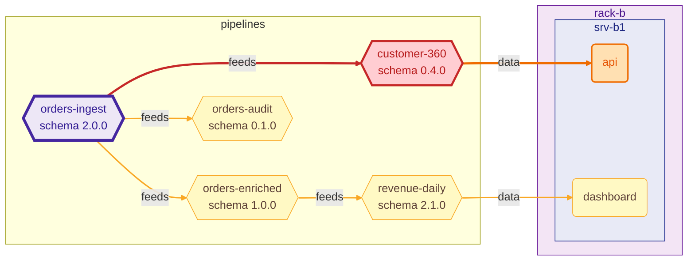

# RippleRack in CI

RippleRack answers one question for a pull request: *does this change to the datacenter break
something downstream?* There are three ways to ask it in CI, from the lowest level to the one that
is ready to use. Pick the one that fits, they build on each other.

| | You write | You get |
|---|---|---|
| [The command as a gate](#the-command-as-a-gate) | a `run:` step | a red check when a consumer breaks |
| [The Markdown report](#the-markdown-report) | the step that posts it | a report to paste anywhere |
| [The GitHub Action](#the-github-action) | a `uses:` step | the gate, the report as one comment that every push updates, and outputs |

## The command as a gate

`ripplerack diff BASE HEAD` compares two versions of a datacenter file, and with
`--fail-on-breaking` it ends with a failure when a consumer would break:

```bash
ripplerack diff base.yaml head.yaml --fail-on-breaking
```

| exit code | meaning |
|-----------|---------|
| `0` | The comparison was made and nothing makes it fail. |
| `1` | The command failed: a file that cannot be read, or is not valid. |
| `2` | A consumer breaks and `--fail-on-breaking` was given, **or** the command line was invalid. |

A CI system treats every code other than `0` as a failure, so the three need no handling to be a
gate. To tell a broken consumer from a mistake in the command line, look at standard output: a
breaking change always prints its result there, and a usage error prints nothing
([Exit codes](output-formats.md#exit-codes)).

`impact` is the same gate for one pipeline and a schema file that you propose:
`ripplerack impact dc.yaml -p orders-ingest -s new-schema.yaml --fail-on-breaking`.

### The file as it was

In a pull request the base is the file as it is in the branch the pull request goes into. A
checkout of the pull request does not have that commit, so ask for it:

```yaml
- uses: actions/checkout@v4
  with:
    fetch-depth: 0          # or fetch just the base commit with git fetch --depth=1 origin <sha>
- run: |
    git show "origin/$BASE_REF:datacenter.yaml" > "$RUNNER_TEMP/base.yaml"
    ripplerack diff "$RUNNER_TEMP/base.yaml" datacenter.yaml --fail-on-breaking
  env:
    BASE_REF: ${{ github.base_ref }}
```

### Installing RippleRack

RippleRack is not on PyPI yet, so install it from the repository, at a release or a commit:

```bash
pip install "git+https://github.com/IzanVil/RippleRack@v0.2.2"
# or, with uv:
uv tool install "git+https://github.com/IzanVil/RippleRack@v0.2.2"
```

`v0.2.2` is the first release with the Markdown report and the action. Pin a tag or a commit,
not `main`, so that a change to RippleRack cannot turn a green check red on its own.

On a runner with no access to PyPI, point pip at a mirror that has RippleRack's dependencies and
`uv_build` (`PIP_INDEX_URL`, or `UV_INDEX_URL` for uv), or build the wheel once with `uv build` and
install it from a folder of wheels with `pip install --no-index --find-links wheels ripplerack`.

### The facts, for a script

`--format json` prints a [versioned document](output-formats.md) instead of tables:

```bash
ripplerack diff base.yaml head.yaml -F json > diff.json
jq -r '.severity, .summary.brokenConsumers' diff.json
jq -r '.schemaChanges[].brokenConsumers[].pipeline' diff.json | sort -u    # who breaks
```

## The Markdown report

`--format markdown` writes the same comparison as a report for people: the schema changes and the
consumers that break in tables, what is at risk, a diagram, and the long lists folded
([the format](output-formats.md#markdown)). It is plain text to put anywhere:

```bash
ripplerack diff base.yaml head.yaml -F markdown > report.md
gh pr comment "$PR_NUMBER" --body-file report.md       # a comment on the pull request
cat report.md >> "$GITHUB_STEP_SUMMARY"                # the summary of the job
```

`gh pr comment` adds a comment on every run. The Action below keeps one.

## The GitHub Action

The Action is in the folder [`action/`](../action) of this repository and does what the sections
above do, together: it installs RippleRack, finds the file in the base commit of the pull request,
compares the two versions, writes the report in the summary of the job, posts it as a comment, and
fails the step if you ask it to when a consumer breaks.

```yaml
name: RippleRack
on:
  pull_request:
    paths: ["datacenter.yaml"]

permissions:
  contents: read
  pull-requests: write          # to post the comment

concurrency:                    # a new push replaces the run in progress
  group: ripplerack-${{ github.ref }}
  cancel-in-progress: true

jobs:
  impact:
    runs-on: ubuntu-latest
    steps:
      - uses: actions/checkout@v4
      - uses: IzanVil/RippleRack/action@v0.2.2
        with:
          head: datacenter.yaml
          fail-on-breaking: "true"
```

A copy to start from is in [`examples/ci/ripplerack.yml`](../examples/ci/ripplerack.yml). The
action is versioned with RippleRack: `@v0.2.2` is the action of the release `v0.2.2` and installs
that release, so pin a tag or a commit. It needs Python 3.11 or newer on the runner, which the
`ubuntu-latest` image has, and it is written with `bash` and `python3`, so it is meant for Linux
and macOS runners.

### Inputs

| input | default | what it does |
|-------|---------|--------------|
| `head` | (required) | Path of the datacenter file in the checked out repository. |
| `base` | empty | Path of the same file before the change. Empty, it is the file at the path of `head` in the commit the pull request is based on. |
| `fail-on-breaking` | `false` | Fail the step, with exit code `2`, when a consumer breaks. The comment is posted first. |
| `comment-on-pr` | `true` | Post the report as a comment on the pull request, and update it on every later run. |
| `github-token` | `${{ github.token }}` | The token that posts the comment. It needs `pull-requests: write`. |
| `max-items` | `25` | How many rows each table or list of the report shows (`0` for all). |
| `diagram` | `true` | Draw the diagram of the impact. |

### Outputs

| output | what it is |
|--------|------------|
| `severity` | `none`, `low`, `medium`, `high` or `critical`: the severity of the whole change. |
| `broken-count` | How many consumers break (pipelines, counted once however many changes break them). |
| `at-risk-count` | How many components are at risk, not counting the consumers that break. A pipeline that one change breaks and another puts at risk is counted as broken only. |
| `report-path` | Path of the Markdown report on the runner. Empty when there was nothing to compare. |

Use them in the steps that follow:

```yaml
      - id: ripplerack
        uses: IzanVil/RippleRack/action@v0.2.2
        with:
          head: datacenter.yaml
      - if: steps.ripplerack.outputs.severity == 'critical'
        run: echo "ask the owners of the consumers before merging"
```

### What the comment looks like

This is the source of the comment for the two example datacenters of the repository
(`ripplerack diff examples/mini_datacenter.yaml examples/mini_datacenter_v2.yaml -F markdown`).
GitHub draws the tables, the folded sections and the diagram:

````markdown
## RippleRack · 🟠 HIGH

`mini-datacenter` → `mini-datacenter` · 2 added · 0 removed · 3 modified · 1 schema change(s) · 1 broken consumer(s)

### 🟠 HIGH · `orders-ingest`

Schema `orders` `1.2.0` → `2.0.0` · change: **major** · suggested version `2.0.0`

**Schema changes**

| level | kind | detail |
| --- | --- | --- |
| **major** | `field_removed` | `field 'amount' removed` |
| **major** | `field_added` | `required field 'amount_cents' added` |

**Broken consumers**

| pipeline | fields | reason |
| --- | --- | --- |
| `customer-360` | `amount` | `field 'amount' removed` |

At risk (1): `api`

<details>
<summary>Diagram of the impact</summary>



</details>

<details>
<summary>Components: 2 added · 0 removed · 3 modified</summary>

| change | kind | id | details |
| --- | --- | --- | --- |
| added | service | `redis` | on `srv-b1` |
| added | pipeline | `orders-audit` | runs on `postgres` |
| modified | server | `srv-b1` | `memory_gb: 96 → 64` |
| modified | pipeline | `orders-enriched` | `inputs: orders-ingest: -amount +amount_cents` |
| modified | pipeline | `orders-ingest` | `schema.version: 1.2.0 → 2.0.0`<br>`schema.fields: changed (see above)` |

</details>

<details>
<summary>Dependencies: 1 added · 0 removed · 1 modified</summary>

| change | dependency | kind |
| --- | --- | --- |
| added | `api → redis` | runtime |
| modified | `spark → kafka` | network → data |

</details>
````

### One comment for each file

The first line of the comment is a hidden marker with a short hash of the path in `head`. The
next run finds the comment by it and edits that one, so five pushes to a pull request leave one
comment, with the report of the last push, and not five. Two files compared in one pull request
(two steps with a different `head`) have a comment each. A comment that starts with the marker but
that the token cannot edit is left alone and a new one is added.

### What it does not do

* **A pull request from a fork** runs with a token that can only read. The comment is not posted
  (a warning says so), but the summary of the job has the report, the outputs are set and
  `fail-on-breaking` still fails the step. Do not use `pull_request_target` to get a token that can
  write: it runs with secrets over code that anyone can send you.
* **A file that the pull request adds** has no earlier version. The step says so in a notice,
  reports `none` and passes.
* **Outside a pull request** there is no base commit and no comment: give the file to compare with
  in `base`.
* **A datacenter that does not validate** fails the step with the message of RippleRack, and posts
  nothing.

### Gating on it

* To block the merge, make the job a *required status check* in the rules of the branch and set
  `fail-on-breaking: "true"`. The comment tells the author why the check is red.
* To warn without blocking, leave `fail-on-breaking` as it is and look at the outputs, or at the
  comment.
* A breaking change is sometimes the right change. The way past the gate is the same as for any
  check: the people who may merge decide, and a pull request that changes the consumers together
  with the schema does not break them (the comparison reads the consumers as they are in `head`).

### Trying the action before you trust it

* **In this repository**, [`action-test.yml`](../.github/workflows/action-test.yml) runs the action
  on the example datacenters on every push that touches it, and checks its outputs and its gate.
* **In your own repository**, point a test branch at the action by its branch, open a pull request
  that changes the datacenter file, and read the comment: `uses: IzanVil/RippleRack/action@<branch>`.
* **Without GitHub**, run the glue of the action as the runner does, with the variables that
  `action.yml` sets. The tests of the repository do it against a copy of the GitHub API
  (`tests/test_action.py`).

### When something is wrong

| you see | because |
|---------|---------|
| `the comment was not posted (HTTP 403)` | The token cannot write: add `pull-requests: write` to `permissions`, or the pull request comes from a fork. |
| `could not fetch the base commit` | The checkout has no `origin` to fetch from. Use `actions/checkout`, or give `base`. |
| `the input base is needed` | The workflow is not a pull request. Give `base`. |
| `could not install RippleRack` | The runner cannot reach PyPI. See [Installing RippleRack](#installing-ripplerack). |
| `RippleRack needs Python 3.11` | Add `actions/setup-python` with Python 3.11 or newer before the step. |
