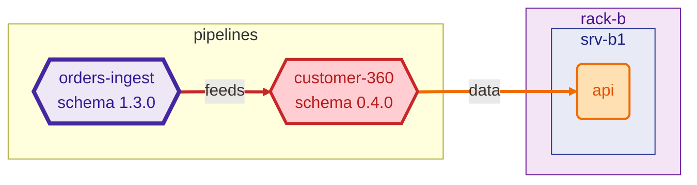

## RippleRack · 🟠 HIGH

`mini-datacenter` → `mini-datacenter-2` · 4 added · 2 removed · 5 modified · 1 schema change(s) · 1 broken consumer(s)

- datacenter `name: mini-datacenter → mini-datacenter-2`
- datacenter `description: Two racks running an e-commerce order analytics stack. → The same racks, one year later.`

### 🟠 HIGH · `orders-ingest`

Schema `orders` `1.2.0` → `1.3.0` · change: **major** · suggested version `2.0.0`

⚠️ The declared version `1.3.0` is too low for a major change (expected ≥ `2.0.0`).

**Schema changes**

| level | kind | detail |
| --- | --- | --- |
| **major** | `field_removed` | `field 'amount' removed` |
| **major** | `field_added` | `required field 'amount_cents' added` |

**Broken consumers**

| pipeline | fields | reason |
| --- | --- | --- |
| `customer-360` | `amount` | `field 'amount' removed` |

At risk (1): `api`

Diagram of the impact

**Removed, but still depended on**

| component | kind | dependents |
| --- | --- | --- |
| `orders-enriched` | pipeline | `revenue-daily` |

**Warnings**

- ⚠️ `datacenter name changed from 'mini-datacenter' to 'mini-datacenter-2': are you comparing different datacenters?`
- ⚠️ `pipeline 'orders-ingest': declared version 1.3.0 is too low for a major change (expected >= 2.0.0)`

**Hints**

- service `dashboard` may have been renamed to `bi-dashboard`

Components: 4 added · 2 removed · 5 modified

| change | kind | id | details |
| --- | --- | --- | --- |
| added | rack | `rack-c` |  |
| added | server | `srv-c1` | in `rack-c` |
| added | service | `bi-dashboard` | on `srv-b1` |
| added | service | `redis` | on `srv-c1` |
| removed | service | `dashboard` | on `srv-b1` |
| removed | pipeline | `orders-enriched` | runs on `spark` |
| modified | rack | `rack-a` | `power_capacity_kw: 2.8 → 3.2` |
| modified | server | `srv-a1` | `cpu_cores: 32 → 48` |
| modified | service | `kafka` | `description: Event broker → Event broker and log` |
| modified | pipeline | `orders-ingest` | `schema.version: 1.2.0 → 1.3.0` `schema.fields: changed (see above)` |
| modified | pipeline | `revenue-daily` | `inputs: -orders-enriched` |

Dependencies: 2 added · 2 removed · 1 modified

| change | dependency | kind |
| --- | --- | --- |
| added | `api → redis` | network |
| added | `bi-dashboard → revenue-daily` | data |
| removed | `api → postgres` | runtime |
| removed | `dashboard → revenue-daily` | data |
| modified | `spark → kafka` | network → data |

