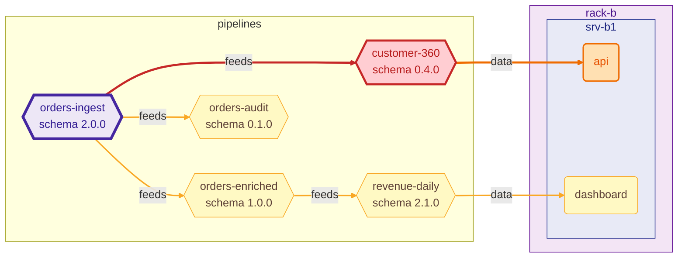

## RippleRack · 🟠 HIGH

`mini-datacenter` → `mini-datacenter` · 2 added · 0 removed · 3 modified · 1 schema change(s) · 1 broken consumer(s)

### 🟠 HIGH · `orders-ingest`

Schema `orders` `1.2.0` → `2.0.0` · change: **major** · suggested version `2.0.0`

**Schema changes**

| level | kind | detail |
| --- | --- | --- |
| **major** | `field_removed` | `field 'amount' removed` |
| **major** | `field_added` | `required field 'amount_cents' added` |

**Broken consumers**

| pipeline | fields | reason |
| --- | --- | --- |
| `customer-360` | `amount` | `field 'amount' removed` |

At risk (1): `api`

Diagram of the impact

Components: 2 added · 0 removed · 3 modified

| change | kind | id | details |
| --- | --- | --- | --- |
| added | service | `redis` | on `srv-b1` |
| added | pipeline | `orders-audit` | runs on `postgres` |
| modified | server | `srv-b1` | `memory_gb: 96 → 64` |
| modified | pipeline | `orders-enriched` | `inputs: orders-ingest: -amount +amount_cents` |
| modified | pipeline | `orders-ingest` | `schema.version: 1.2.0 → 2.0.0` `schema.fields: changed (see above)` |

Dependencies: 1 added · 0 removed · 1 modified

| change | dependency | kind |
| --- | --- | --- |
| added | `api → redis` | runtime |
| modified | `spark → kafka` | network → data |

