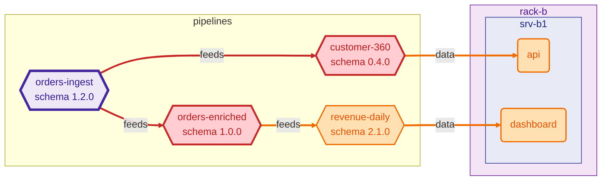

## RippleRack · 🔴 CRITICAL

Changing `orders-ingest` in `mini-datacenter` reaches 5 components: ❌ broken 2 · ⚠️ at risk 3

Schema `orders` `1.2.0` → `2.0.0` · change: **major** · suggested version `2.0.0`

**Schema changes**

| level | kind | detail |
| --- | --- | --- |
| **major** | `field_removed` | `field 'amount' removed` |
| **major** | `field_added` | `required field 'amount_cents' added` |

**Broken consumers**

| pipeline | fields | reason |
| --- | --- | --- |
| `customer-360` | `amount` | `field 'amount' removed` |
| `orders-enriched` | `amount` | `field 'amount' removed` |

At risk (3): `api`, `dashboard`, `revenue-daily`

**Downstream components**

| status | component | kind | hops | path |
| --- | --- | --- | ---: | --- |
| ❌ broken | `customer-360` | pipeline | 1 | `orders-ingest → customer-360` |
| ❌ broken | `orders-enriched` | pipeline | 1 | `orders-ingest → orders-enriched` |
| ⚠️ at risk | `api` | service | 2 | `orders-ingest → customer-360 → api` |
| ⚠️ at risk | `revenue-daily` | pipeline | 2 | `orders-ingest → orders-enriched → revenue-daily` |
| ⚠️ at risk | `dashboard` | service | 3 | `orders-ingest → orders-enriched → revenue-daily → dashboard` |

**Diagram of the impact**

