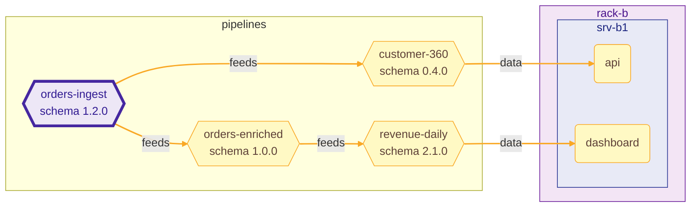

## RippleRack · 🟢 LOW

Changing `orders-ingest` in `mini-datacenter` reaches 5 components.

Schema `orders` `1.2.0` → `1.3.0` · change: minor · suggested version `1.3.0`

**Schema changes**

| level | kind | detail |
| --- | --- | --- |
| minor | `field_added` | `optional field 'channel' added` |

✅ No consumer breaks.

Downstream components (5)

| status | component | kind | hops | path |
| --- | --- | --- | ---: | --- |
| affected | `customer-360` | pipeline | 1 | `orders-ingest → customer-360` |
| affected | `orders-enriched` | pipeline | 1 | `orders-ingest → orders-enriched` |
| affected | `api` | service | 2 | `orders-ingest → customer-360 → api` |
| affected | `revenue-daily` | pipeline | 2 | `orders-ingest → orders-enriched → revenue-daily` |
| affected | `dashboard` | service | 3 | `orders-ingest → orders-enriched → revenue-daily → dashboard` |

Diagram of the impact

